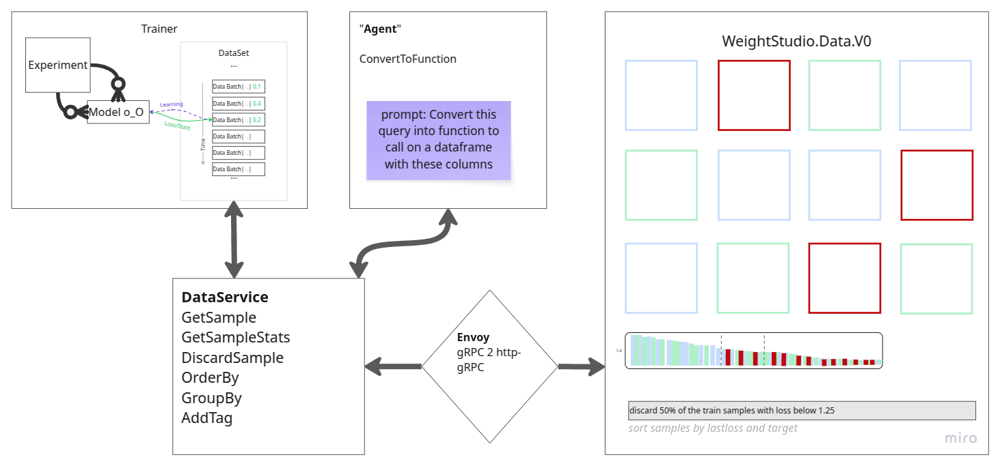

Weights Studio UI
=================

Weights Studio is the visual frontend for WeightsLab experiments.
It ships **inside the Python package**.
``wl.serve()`` serves the bundled SPA from your training process and proxies
gRPC-Web to its backend; ``weightslab start`` runs the same server as a
standalone Python process.

Architecture
------------

Runtime path:

1. Browser (served from ``wl.serve()`` or ``weightslab start``)
2. The UI server (a background thread of ``wl.serve()``, or ``weightslab start``),
   pure-Python HTTP server that:

   - Serves the pre-built Weights Studio SPA (vendored in ``weightslab/ui/static/``)
   - Translates gRPC-Web (browser) to raw gRPC (backend) via an embedded proxy

3. WeightsLab Python gRPC service (started by ``wl.serve()``)

Quick start
-----------

1. Install WeightsLab::

     pip install weightslab

2. In your training script, start the backend (and the UI)::

     import weightslab as wl
     wl.serve(serving_grpc=True)
     # ... training loop ...
     wl.keep_serving()

3. Run the script: Weights Studio opens in your browser (the URL is printed
   too; ``http://localhost:8080`` by default, a free port when that one is
   busy). It stops when the training process exits.

To keep a UI up across training runs, start it yourself before the script
(``wl.serve()`` then uses it rather than starting its own)::

    weightslab start

``weightslab start`` auto-discovers the backend on ``localhost:50051`` (default).
Pass ``--backend-port`` to override::

    weightslab start --backend-port 50052

To suppress auto-opening the browser::

    weightslab start --no-browser
    # or, for the UI wl.serve() serves: wl.serve(ui_open_browser=False)

.. _studio-features:

Sections
--------

Everything the studio puts on screen, what it is for, and how to drive it —
grouped into four parts. Each page below covers its own subsections; see the
page itself for the details.

.. toctree::
   :maxdepth: 2

   landing_page
   agent
   left_panel
   main_area
   more/index

- :doc:`landing_page`, the pre-experiment surface: agent chat, local Jupyter,
  Colab quickstarts, :ref:`report generation <studio-report-generation>`, and
  the :ref:`embedded-notebook`.
- :doc:`agent`, the docked chat bar and Agent Window: commands, ``/loop``
  jobs, setup, and history behavior.
- :doc:`left_panel`, run management (training controls, evaluation, mode,
  auto-refresh), in-training hyperparameter edits, tag painter mode, metadata
  sorting/histograms, and data actions (save, export).
- :doc:`main_area`, the Plots Board (search, merged curves, error bands,
  right-click actions, resource monitoring) and the Data Board (grid/list
  modes, quick filters, selection, tagging, the detail modal).
- :doc:`more/index`, More to know.
